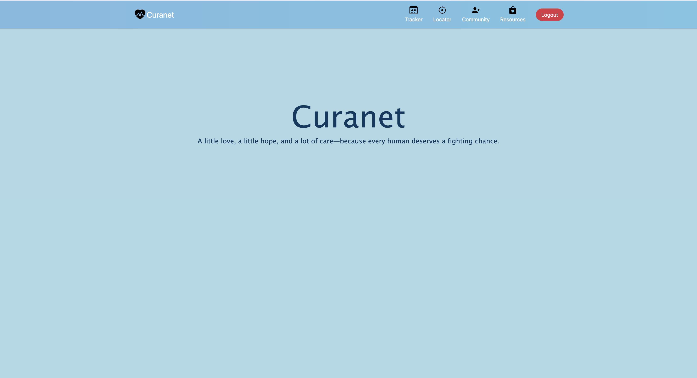
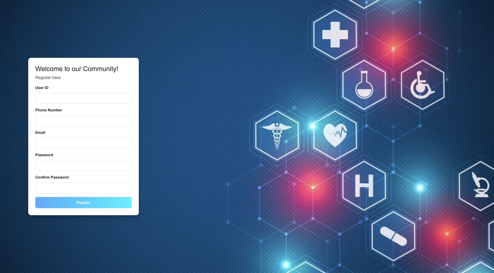
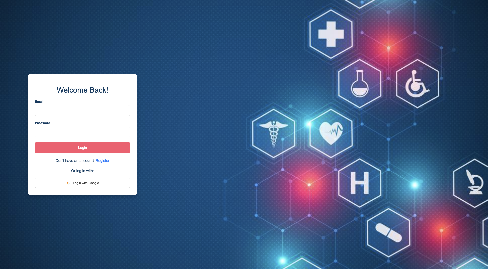
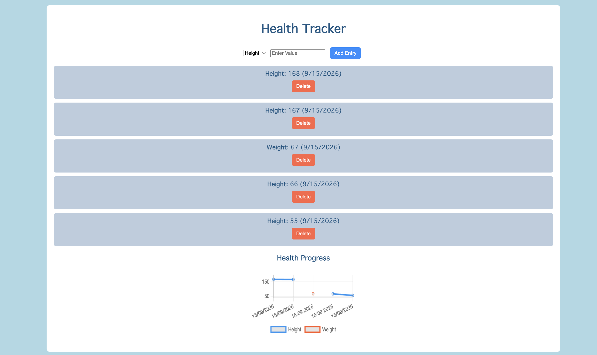
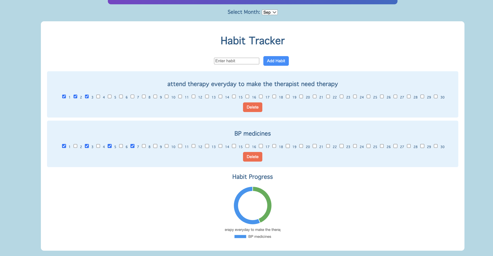
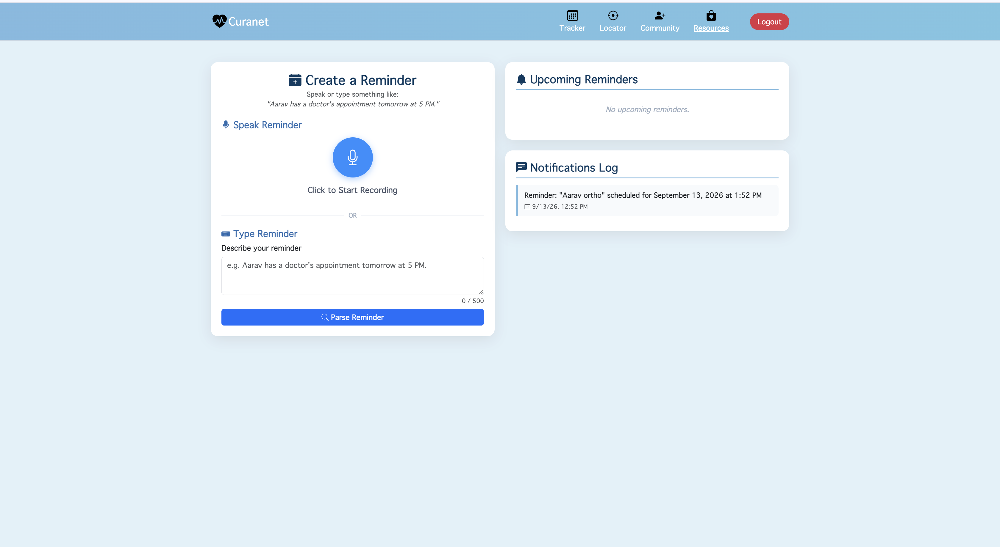
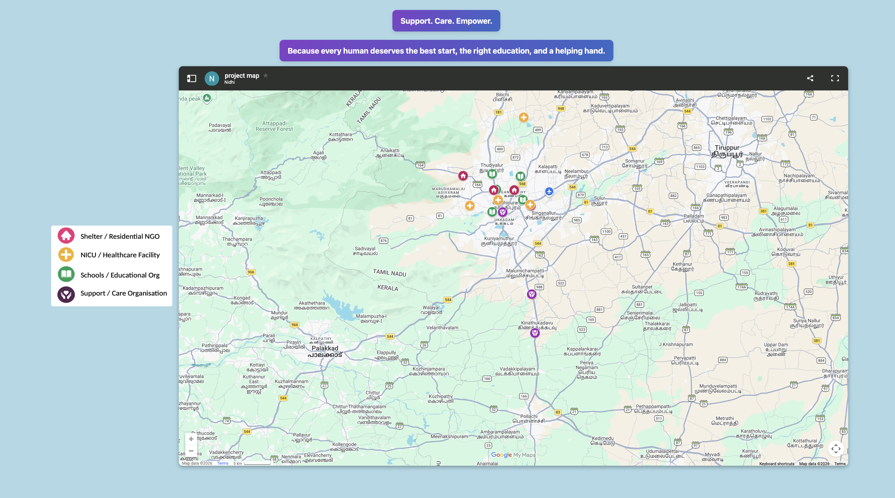
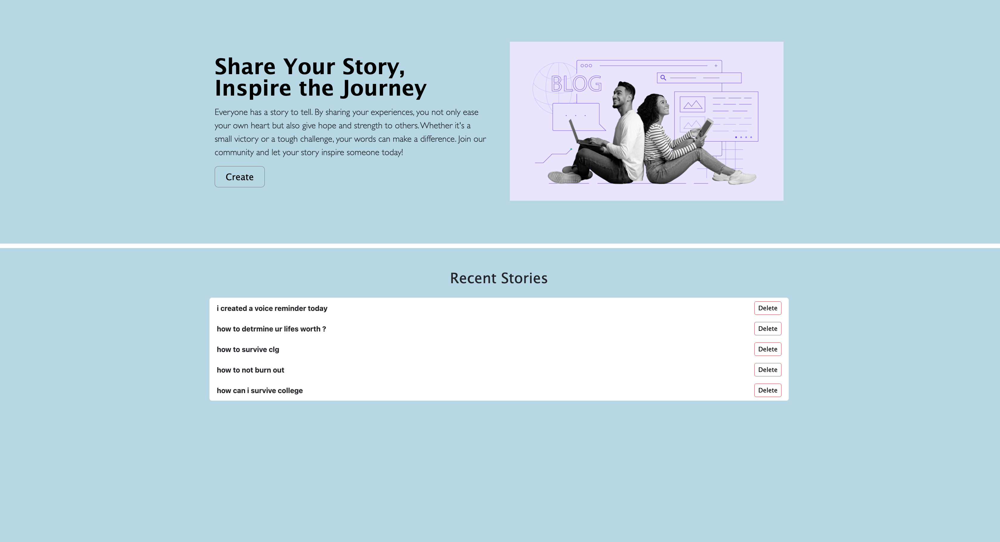

# Curanet - Healthcare Management Platform

Curanet is a web application designed to help caregivers track personal health vitals, manage daily habits, find nearby healthcare facilities, participate in community discussions, and schedule reminders with optional voice input and email alerts.

---

## Tech Stack

### **Backend & Architecture**
- **Node.js & Express.js**: REST routing, session management, and server-side request processing.
- **PostgreSQL (`pg`)**: Relational database for storing user accounts, metrics, habits, posts, and scheduled reminders.
- **Passport.js**: Authentication handling via local credentials (`bcrypt`) and Google OAuth 2.0 (`passport-google-oauth2`).
- **Node-Cron**: Automated background job scheduling for periodic reminder checks.
- **Resend API**: Email delivery service for sending reminder notifications.
- **Groq (Whisper) & Google Gemini**: Speech-to-text audio transcription with fallback handling.
- **Chrono-node & Gemini**: Natural language date/time parsing and structured entity extraction.

### **Frontend & UI**
- **EJS**: Server-side rendering of dynamic views and layouts.
- **CSS & HTML**: Custom responsive UI styling and layout design.
- **JavaScript (ES6+)**: Client-side audio recording (MediaStream Recording API), form validation, and interactive UI logic.
- **Google My Maps**: Embedded interactive map integration for locating nearby hospitals, clinics, and pharmacies.

---

## Application Preview & Pages

### 1. Landing / Home Page
> **Page**: `views/home.ejs`  
> **Description**: The primary entry point introducing the platform features with quick navigation to authentication, health tracking tools, and community sections.



---

### 2. User Registration
> **Page**: `views/register.ejs`  
> **Description**: Dedicated registration interface allowing new users to create accounts using standard credentials or sign in with Google.



---

### 3. User Login
> **Page**: `views/home.ejs` (Login view)  
> **Description**: Secure authentication form with email/password validation and Google OAuth single sign-on support.



---

### 4. Health Metrics Tracker
> **Page**: `views/tracker.ejs` (Health Tracker tab)  
> **Description**: Log and monitor essential health indicators such as blood pressure, heart rate, blood sugar, weight, and sleep hours over time.



---

### 5. Habit Tracker
> **Page**: `views/tracker.ejs` (Habit Tracker tab)  
> **Description**: Track daily lifestyle routines like water intake, exercise, medication adherence, and screen time to maintain healthy habits.



---

### 6. Voice & Medication Reminders
> **Page**: `views/tracker.ejs` (Reminders section)  
> **Description**: Set healthcare and medication reminders using voice or text. Audio is transcribed and parsed into dates and times, saved to the database, and sent as scheduled email reminders via Resend.


#### AI & Speech Processing Workflow

The reminders feature allows users to speak or type reminders in natural language (e.g., *"Doctor's appointment tomorrow at 5 PM"*). The system processes and schedules them through the following pipeline:

1. **Audio Recording & Transcription**:
   - The user records voice input in the browser via the MediaStream Recording API.
   - The backend sends the audio to **Groq's Whisper API** (`whisper-large-v3-turbo`) for fast transcription.
   - If Groq encounters a rate limit (HTTP 429) or server error, the service automatically falls back to **Google Gemini 2.0 Flash** to transcribe the audio without failing the request.

2. **Date & Entity Extraction**:
   - The transcribed text is first parsed using **chrono-node** to extract dates and times locally.
   - If the phrasing is conversational or chrono-node cannot parse it, a fallback prompt is sent to **Gemini 2.0 Flash** to extract the event title, date, and time in structured JSON format.
   - The system checks for missing dates/times, validates that the event is in the future, and normalizes the timestamp (`Asia/Kolkata` timezone to UTC).

3. **Database Storage & Scheduled Delivery**:
   - Validated reminders are stored in PostgreSQL.
   - A background job (`node-cron`) checks every minute for pending reminders and triggers alert emails via the **Resend API**.

---

### 7. Healthcare Facility Finder
> **Page**: `views/locator.ejs`  
> **Description**: Interactive map interface that uses geolocation to help users search for facilities and institutions.


---

### 8. Community Discussions
> **Page**: `views/community.ejs` & `views/open.ejs`  
> **Description**: A community discussion board where users can share , view and delete experiences for awareness.



---

## 🚀 Getting Started Locally

### Prerequisites
- [Node.js](https://nodejs.org/) (v16+ recommended)
- [PostgreSQL](https://www.postgresql.org/) database instance

### 1. Clone the repository
```bash
git clone <your-repository-url>
cd "Healthcare Project"
```

### 2. Install dependencies
```bash
npm install
```

### 3. Configure environment variables
Create a `.env` file in the project root:
```env
SESSION_SECRET=your_session_secret
PG_USER=your_postgres_user
PG_HOST=localhost
PG_DATABASE=your_database_name
PG_PASSWORD=your_postgres_password
PG_PORT=5432
GOOGLE_CLIENT_ID=your_google_client_id
GOOGLE_CLIENT_SECRET=your_google_client_secret
GROQ_API_KEY=your_groq_api_key
GEMINI_API_KEY=your_gemini_api_key
RESEND_API_KEY=your_resend_api_key
RESEND_FROM_EMAIL=onboarding@resend.dev
```

### 4. Database Setup
Initialize the database tables using the schema in `queries.sql`.

### 5. Run the application
```bash
# For development with nodemon
npm run dev

# Or for production
npm start
```

Access the application in your browser at `http://localhost:3000`.
